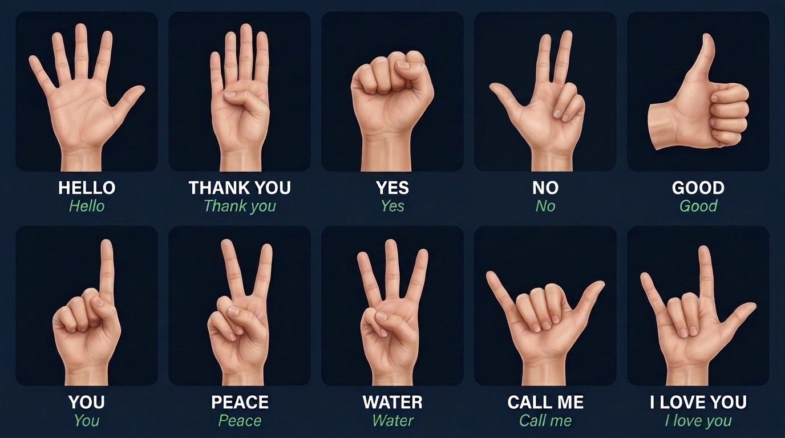

# Gesture Manual & Hand Sign Guide

This manual explains **which hand to use**, provides **hand drawing illustrations**, and shows **how to open and close the in-app manual**.

---

## 1. Hand Drawing Illustration Manual

Here is the textbook-style hand sketch drawing manual illustrating all 10 hand signs:

### Hand Skeleton Anatomy & Joint State Diagram

---

## 2. Which Hand Should You Use?

> **You can use EITHER your Right Hand or your Left Hand!**

- **Both hands are supported**: The system automatically detects whether you are using your left or right hand and normalizes the coordinates so signs work identically.
- **Mirror View**: The webcam feed is flipped horizontally like a mirror so your movements on screen feel natural and intuitive.
- **Single Hand at a time**: Keep only **one** hand clearly in the camera frame at a time.

---

## 3. How to Open & Close the In-App Manual

In [`src/run_app.py`](src/run_app.py), you can toggle the manual on or off at any time:

- **Method A (Keyboard)**: Press **`h`** or **`H`** (or **`?`**) on your keyboard to toggle between open and closed.
- **Method B (Mouse Click)**: 
  - When closed: click the green **`[H] Open Manual`** button in the top-right corner of the video window.
  - When open: click the red **`Close [H]`** button at the top of the manual card.

Starting state is closed so your webcam view remains clean and unobstructed.

---

## 4. Complete Gesture Reference Table

The rule engine checks 5 finger values in order: **(Thumb, Index, Middle, Ring, Pinky)**:
- **1** = **Extended** (straight / open)
- **0** = **Curled** (folded into your palm)

| # | Spoken Word | Finger Pattern `[T, I, M, R, P]` | How to Pose Your Hand | Visual / Sign Cue |
|:---:|:---|:---:|:---|:---|
| 1 | **"Hello"** | `(1, 1, 1, 1, 1)` | Extend **all 5 fingers** flat and open. | 🖐️ Open Palm / Wave |
| 2 | **"Thank you"** | `(0, 1, 1, 1, 1)` | Extend **Index, Middle, Ring, Pinky** together; tuck **Thumb** flat against your palm. | ✋ Flat hand (Salute) |
| 3 | **"Yes"** | `(0, 0, 0, 0, 0)` | Curl **all 5 fingers** into a tight fist. | ✊ Closed Fist (ASL 'Yes' nod) |
| 4 | **"No"** | `(1, 1, 1, 0, 0)` | Extend **Thumb, Index, and Middle**; curl **Ring and Pinky** into palm. | 🫰 3 fingers extended |
| 5 | **"Good"** | `(1, 0, 0, 0, 0)` | Extend **Thumb pointing UP**; curl the other 4 fingers into a fist. | 👍 Thumbs Up |
| 6 | **"You"** | `(0, 1, 0, 0, 0)` | Extend **Index finger** straight up; curl Thumb and other 3 fingers. | ☝️ Pointing finger |
| 7 | **"Peace"** | `(0, 1, 1, 0, 0)` | Extend **Index and Middle** in a "V" shape; curl Thumb, Ring, and Pinky. | ✌️ Peace / Victory sign |
| 8 | **"Water"** | `(0, 1, 1, 1, 0)` | Extend **Index, Middle, and Ring** upward (forming a "W"); curl Thumb and Pinky. | 🖖 "W" sign (ASL Water) |
| 9 | **"Call me"** | `(1, 0, 0, 0, 1)` | Extend **Thumb and Pinky** outward; curl Index, Middle, and Ring. | 🤙 "Shaka" / Phone call sign |
| 10 | **"I love you"** | `(1, 1, 0, 0, 1)` | Extend **Thumb, Index, and Pinky**; curl Middle and Ring into palm. | 🤟 ASL "ILY" sign |

---

## 5. Tips for Best Recognition

- **Lighting**: Ensure your hand is well-lit from the front so the camera can clearly detect all 21 hand joints. Avoid bright backlight directly behind your hand.
- **Facing**: Face your palm toward the camera (for gestures 1, 2, 7, 8, 10) or keep your hand upright (for Thumbs Up "Good").
- **Finger Bars**: Watch the 5 orange bars on the left side of the screen (**Thumb, Index, Middle, Ring, Pinky**). They show real-time extension (longer bar = more bent/curled, empty = straight).
